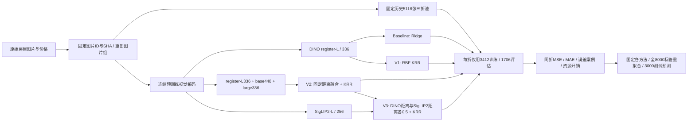

# 报告主线与证据地图

研究问题：在约 8,000 张有价格标签的房屋图片上，回归函数与预训练视觉表征融合如何影响泛化？小样本下局部微调是否提供额外收益？

主方法表使用 Baseline、V1、V2、V3 四个报告编号。它们是对历史路线的整理和同折重算，不伪装成最初按编号预注册的四次实验。所用权重、参数与历史划分经过探索；明确写在局限性中。

建议四页正文结构（参考文献另按作业允许的第五页安排）：

1. **问题与假设**：价格也受位置、面积、交易时间等不可见因素影响；图像回归的误差不能全部归咎于模型欠拟合。提出线性、非线性、同类表征融合、异质表征融合四个问题。引用方法原论文，解释采用预训练特征的理由。
2. **数据与方法**：写清 8000/3000、固定 5118 三折池及历史校准/开发集的角色；重复组防跨折；输入预处理、有效 patch 池化、二段归一化与回归器公式；只在当前训练折计算 target mean/std 和核中心化统计。
3. **结果与消融**：主表使用本包同折分数；列出每折效果而非只报最佳一折。Baseline→V1 检验回归非线性，V1→V2 检验多表征组合，V2→V3 检验增加 SigLIP2 的整体收益。均值预测是额外 sanity check。另表简报微调/LoRA 的负结果，不用不同划分分数证明提升。
4. **分析与局限**：按价格区间和大误差图片比较、描述算力与收益、历史选择偏差、缺少地理信息、SigLIP2 课程许可边界。区分公开榜单、历史开发集与当前 OOF。结论回答哪类方法在当前固定数据与预算下更有效，不扩展为“微调永远无效”。

KRR 的核心：对每个特征块分别 L2 归一化后除以 sqrt(2)，构造

`K(x,z) = exp(-2 × Σ w_j ||f_j(x)-f_j(z)||²)`

在当前训练集上中心化 K，以 `alpha=0.3` 解带正则的回归系数。DINO 三支权重为 .4/.15/.45；V3 将整个 DINO 距离乘 .5，再加 .5 SigLIP2 距离。它是**特征距离的融合**，不是三个房价预测直接取平均，也不是 cross-attention。

### 数据与证据位置

| 论述 | 文件 |
|---|---|
| 方法与固定超参数 | `METHODS.json` |
| 精确图片名单、分组、三折 | `data/ROWS.csv` |
| 特征和原图片对应、来源校验 | `data/PROVENANCE.json`、`ASSET_MANIFEST.json` |
| 模型版本、输入处理、权重 SHA | `MODEL_SOURCES.json`、`team_extract.py` |
| 本次同折测量 | `evidence/current_reproduction/` |
| 每个版本真正训练什么 | `run_experiments.py` 的 `predict_fit` |
| 早期 GPU 微调/LoRA 结果 | `evidence/historical_METHODS.csv`、`historical_RESOURCE_AUDIT.csv` |
| 组员实际复现环境和耗时 | 新运行的 `runs/.../STATUS.json`、`SCORES_BY_FOLD.csv`、`logs/` |

历史 GPU 受控实验：末四层微调＋KRR 的 OOF MSE≈77,456，对照同骨干冻结＋KRR≈77,861；LoRA＋KRR≈77,587；两者均未超过 S0≈68,047。这样能够支持“这次微调的增益小于特征融合”，不能证明所有微调配置都失败。全参数微调目前只有代码/机械验证，尚无回传完整准确率结果。

不要写：V3靠GPU训练降低了MSE；八千张全部用于OOF训练；历史DEV是盲测；SIGLIP2已获老师许可；所有方法均使用相同视觉骨干；本包包含已完成全量微调结果。

可以写：固定预训练特征在本任务上训练了不同回归器；多表征融合在同一历史三折评估中取得更低MSE；GPU主要承担视觉编码，CPU承担回归求解；实际云端微调试验提供了计算成本与收益的补充对照。
